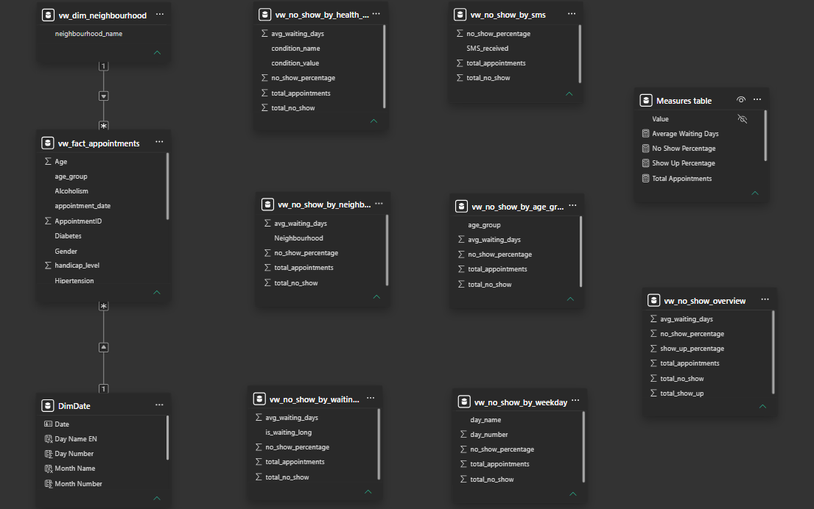
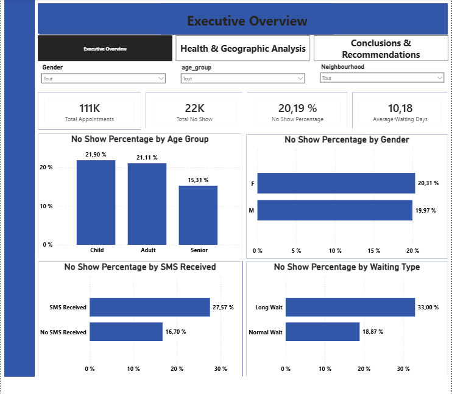
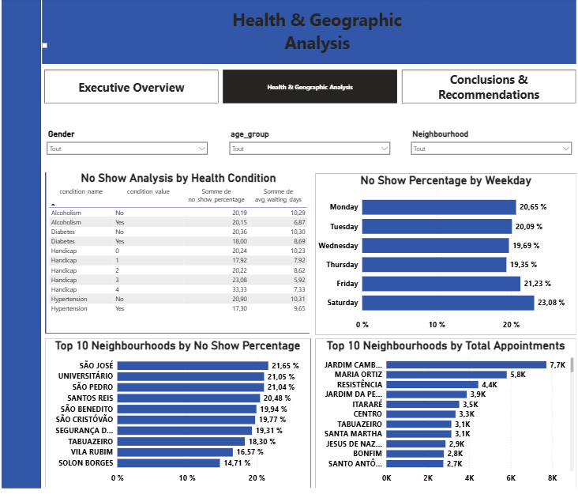
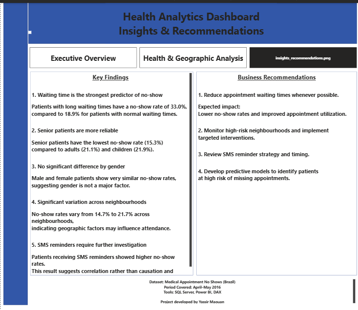

# Medical Appointment No-Show Analysis | SQL Server & Power BI

## Project Overview

This project analyzes medical appointment attendance patterns using **SQL Server** and **Power BI**.

The objective is to identify factors associated with missed medical appointments and provide data-driven insights to help healthcare providers improve appointment attendance and resource planning.

The project focuses on **SQL-based business analysis**, using analytical views to calculate and aggregate results before visualizing them in Power BI.

## Business Problem

Missed medical appointments can create operational inefficiencies, increase healthcare costs, and reduce access to healthcare services.

This project investigates the following questions:

- Which age groups have higher no-show rates?
- How does waiting time relate to missed appointments?
- Are SMS reminders associated with appointment attendance?
- Do no-show rates differ between male and female patients?
- How do attendance patterns vary across neighbourhoods?
- Are certain health conditions associated with higher no-show rates?

## Dataset

**Medical Appointment No Shows — Brazil**

- **110,527 medical appointments**
- **Period:** April–May 2016
- **Source:** [Kaggle – Medical Appointment No Shows](https://www.kaggle.com/datasets/joniarroba/noshowappointments)

The dataset includes patient characteristics, scheduled and appointment dates, neighbourhoods, health conditions, SMS reminders, and appointment attendance outcomes.

## Tools & Technologies

- **SQL Server** — Data preparation and analytical views
- **SQL** — Aggregations, grouping, conditional calculations, and data transformation
- **Power BI** — Interactive dashboards and visualizations
- **DAX** — KPIs and reporting measures

## SQL Data Preparation & Analysis

SQL Server was used to prepare appointment data and perform analytical calculations before visualization in Power BI.

The project combines an appointment-level fact view, supporting dimensions, and several pre-aggregated SQL analytical views.

### Core Data Model

- `vw_fact_appointments` — Appointment-level data
- `vw_dim_neighbourhood` — Neighbourhood dimension
- `DimDate` — Calendar dimension used in Power BI

### SQL Analytical Views

- `vw_no_show_overview` — Overall appointment attendance metrics
- `vw_no_show_by_age_group` — No-show analysis by age group
- `vw_no_show_by_gender` — Attendance comparison by gender
- `vw_no_show_by_sms` — SMS reminder analysis
- `vw_no_show_by_waiting_type` — Waiting-time analysis
- `vw_no_show_by_weekday` — Attendance patterns by weekday
- `vw_no_show_by_neighbourhood` — Geographic analysis
- `vw_no_show_by_health_condition` — Health-condition analysis

These views provide aggregated analytical results used directly in Power BI visualizations.

This approach demonstrates the ability to perform business analysis in SQL rather than relying exclusively on DAX calculations.

## Power BI Data Model

The Power BI model contains a central appointment fact table connected to supporting dimensions, alongside independent analytical tables generated from SQL views.

This structure combines appointment-level data with pre-aggregated analytical results.



## Power BI Dashboard

The report contains three analytical pages.

### 1. Executive Overview

This page provides a high-level overview of medical appointment attendance.

**Key KPIs:**

- Total Appointments
- Total No Shows
- No-Show Percentage
- Average Waiting Days

**Analysis:**

- No-Show Percentage by Age Group
- No-Show Percentage by Gender
- No-Show Percentage by SMS Received
- No-Show Percentage by Waiting Time Category



### 2. Health & Geographic Analysis

This page explores appointment attendance patterns across health conditions, weekdays, and neighbourhoods.

**Analysis:**

- Health Conditions Overview
- No-Show Percentage by Weekday
- Top Neighbourhoods by No-Show Percentage
- Top Neighbourhoods by Total Appointments



### 3. Insights & Recommendations

This page summarizes the main findings and proposes potential actions to improve appointment attendance.



## Key Findings

### 1. Longer Waiting Times Are Associated With Higher No-Show Rates

Patients with longer waiting times showed higher no-show rates than patients with shorter waiting times.

This suggests that waiting time may be an important factor to consider when improving appointment attendance.

### 2. Senior Patients Show Lower No-Show Rates

Senior patients demonstrated relatively low no-show rates compared with other age groups.

### 3. Gender Differences Are Limited

Male and female patients showed similar attendance patterns, suggesting that gender alone may not be a major differentiating factor.

### 4. Geographic Differences Exist

No-show rates varied across neighbourhoods, highlighting opportunities for further geographic analysis.

### 5. SMS Reminders Require Further Investigation

Patients who received SMS reminders showed higher no-show rates in the descriptive analysis.

However, this relationship does not establish causation. Other factors, including waiting time and patient characteristics, may influence the observed results.

## Business Recommendations

Based on the analysis, the following actions could be explored:

1. **Reduce waiting times:** Review appointment scheduling processes to minimize unnecessary delays.
2. **Monitor high-risk neighbourhoods:** Investigate areas with consistently higher no-show rates.
3. **Evaluate SMS reminder strategies:** Examine reminder timing and patient characteristics before assessing effectiveness.
4. **Explore predictive modeling:** Develop statistical or machine learning models to identify patients at higher risk of missing appointments.

These recommendations are exploratory and would require further validation before implementation.

## Repository Structure

```text
Medical-Appointment-No-Show-Analysis/
├── README.md
├── medical_appointment_views.sql
├── PowerBI/
│   └── Medical_Appointment_No_Show.pbix
└── Images/
    ├── data_model.png
    ├── executive_overview.png
    ├── health_geographic_analysis.png
    └── insights_recommendations.png
```

## How to Explore the Project

1. Review `medical_appointment_views.sql` to understand the SQL analytical views.
2. Open `Medical_Appointment_No_Show.pbix` in Power BI Desktop.
3. Configure the SQL Server connection if a data refresh is required.
4. Explore the interactive dashboard pages and analytical results.

## Project Purpose

This project demonstrates practical Data Analyst skills, including:

- SQL-based data preparation
- Analytical queries and aggregations
- Data modeling
- Power BI dashboard development
- Business problem analysis
- Interpretation of results
- Data-driven recommendations

The project illustrates the analytical process from defining business questions and preparing data to presenting findings and proposing potential improvements.
